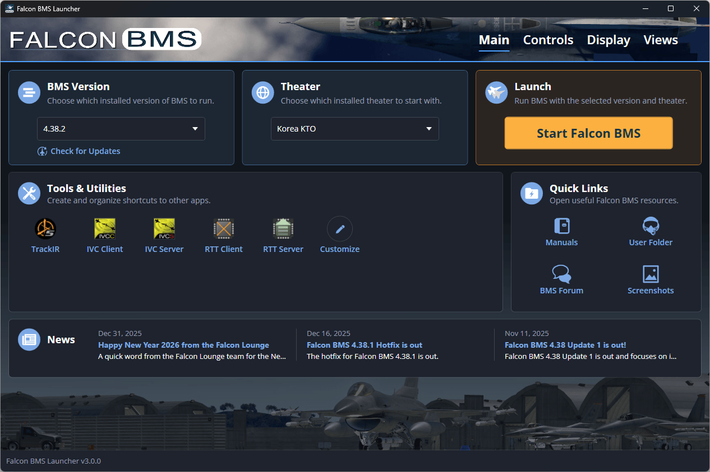
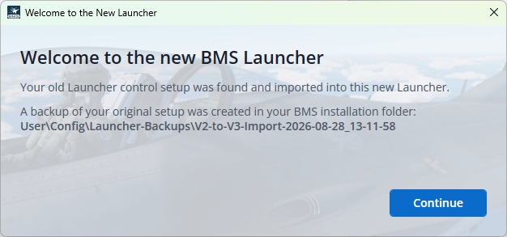
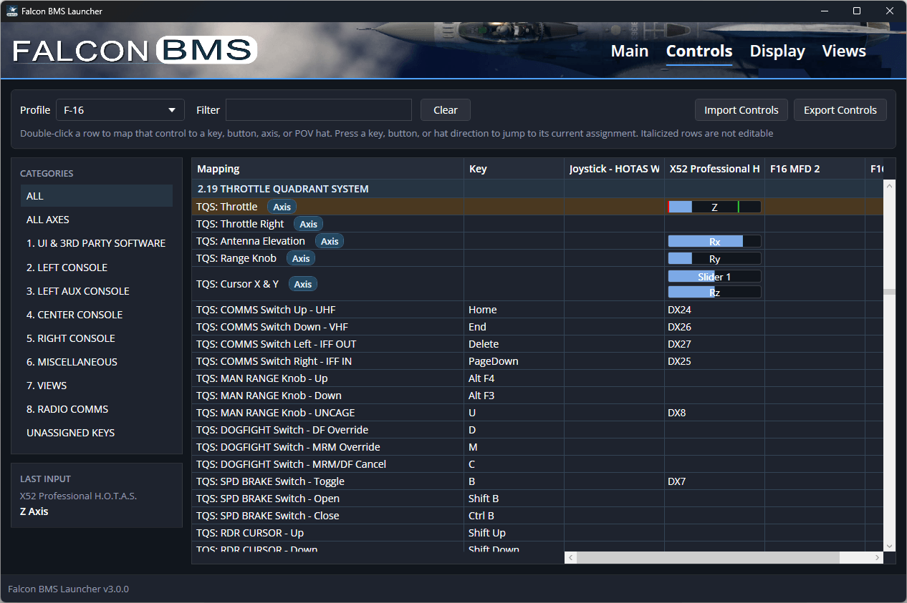
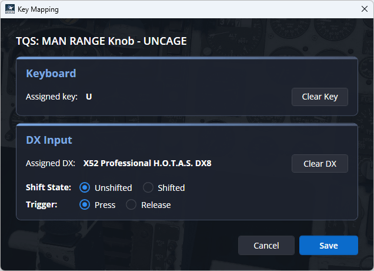
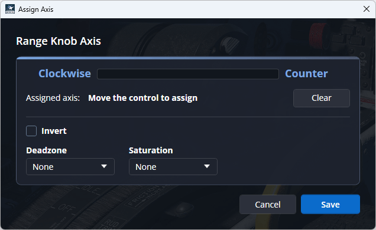
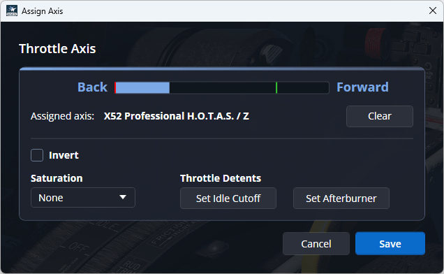
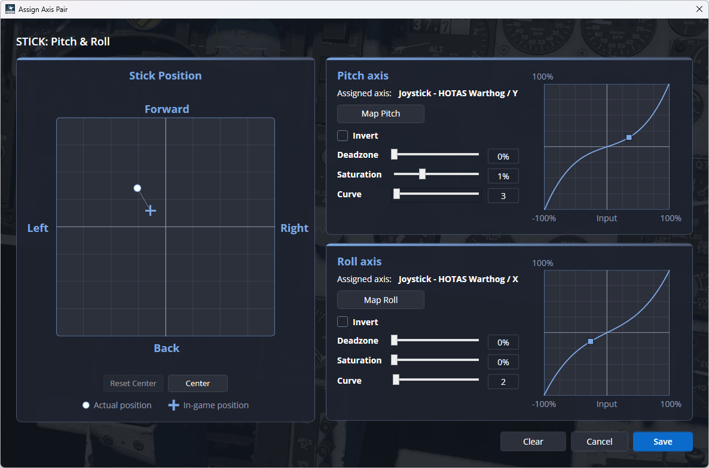

# Falcon BMS Launcher



Falcon BMS Launcher v3 has been redesigned from the ground up to make control setup easier to understand, edit, and customize, all while retaining your existing assignments as Falcon BMS adds or updates controls.

This Launcher is compatible with both Windows and Linux.


## Contents

- [Getting Started](#getting-started)
  - [Checking for Updates]{#checking-updates} 
  - [First Run on a New Install](#fresh-install)
  - [Upgrading From an Older Version](#v2-import)
- [Assigning Controls](#assigning-controls)
  - [Mapping a Key or Button](#mapping-key-button)
  - [Mapping an Axis](#mapping-axis)
  - [Mapping a Throttle](#mapping-throttle)
  - [Mapping the Stick and Cursor](#mapping-stick)
- [Logging](#logging)
- [Developer Details](#developer-details)
  - [Dependencies (NuGet)](#dependencies)
  - [Architecture Overview](#architecture)

<a id="getting-started"></a>
## Getting Started

Launcher v3 is included with Falcon BMS versions 4.38.2 and newer.

After installing Falcon BMS 4.38.2, a shortcut to the Launcher will be added to your desktop.

You can also run the Launcher by opening your Falcon BMS installation folder, going to the ‘Launcher’ folder, and double-clicking ‘FalconBMS.Launcher.exe’.

<a id="checking-updates"></a>
### Check for Updates
The Launcher allows you to check for updates for your installed versions of Falcon BMS.

To check for updates, select the version of Falcon BMS you want to update from the 'BMS Version' dropdown, then click "Check for Updates".

The Launcher will close while the BMS Updater checks for and installs any updates.

Whether an update is found or not, you must manually reopen the Launcher after the update check is complete.

**Note**: This new Launcher is only compatible with Falcon BMS versions 4.38 and newer.


<a id="fresh-install"></a>
### First Run on a New Falcon BMS 4.38 Install
When running Launcher v3 for the first time on a new Falcon BMS installation, the Launcher will start normally and allow you to begin setting up your controls.

<a id="v2-import"></a>
### First Run After Updating From an Older Version of Falcon BMS 4.38
Launcher v3 uses a new control file system that is not compatible with older versions of the Launcher.

After updating from an older version of Falcon BMS, Launcher v3 will check for existing Launcher v2 KEY and XML control files. If found, it will automatically perform a one-time conversion into the new Launcher v3 format.

A backup of your older Launcher v2 files will automatically be created in:
\User\Config\Launcher-Backups

When the conversion is complete, the Launcher will start normally and allow you to continue setting up your controls.



If any mappings could not be converted, a message will show which controls couldn't be imported.

Note: Manually modifying the KEY or XML files will cause the Launcher to become out-of-sync with changes you've made.

<a id="assigning-controls"></a>
## Assigning Controls

The Launcher comes with a few pre-configured setups for popular devices, but you can add and customize keys, buttons, and axes by clicking on the 'Controls' tab near the top right of the Launcher window.



The Controls tab is divided into four panels that work together to help you set up and customize your controls.
- Top panel: Aircraft profile selection, text filtering, import/export
- Category panel: Filters the Mapping table to only show controls within the selected category
- Last input: Displays the last key press, button press, POV hat direction, or axis movement
- Mapping panel: Used to view and modify your keyboard and device controls

Clicking any key or button will highlight mapped input in the table

<a id="mapping-key-button"></a>
### Mapping a Key or Button

To assign a key or button to a control, double-click a row in the Mapping table.



When the popup window appears, simply press a key or button to assign it to this mapping, then click the 'Save' button.

If the key or button is already used elsewhere, a warning message will display. You can still reassign the input by clicking the 'Save' button.

For DX inputs, you can assign a button to a shifted state or have the assigned control activate when the button is released rather than pressed.

- First select "SHIFTED" and/or "RELEASE", then press a device's button
- "SHIFTED" and/or "RELEASE" will display in the Assigned DX line to let you know when either option is set

- <a id="mapping-axis"></a>
### Mapping an Axis
All axis rows can easily be found in the Mapping table by selecting "ALL AXES" in the Category panel.

To map an axis, double-click an axis row in the Mapping table. A popup window will appear for that control.



When an axis is not mapped, the popup will ‘listen’ for movement.

To assign an axis, move the control through its range of motion until the Launcher detects it.

There are options to tune each axis:
- Checking ‘Invert’ reverses the axis direction, so the control moves in the opposite direction in-game.
 - Increasing Saturation makes smaller physical movements produce larger movements in-game.

 <a id="mapping-throttle"></a>
#### Mapping a Throttle

Double-clicking ‘TQS: Throttle’ in the Mapping table opens a special throttle-specific window.



**Afterburner position** <br>
Once the throttle axis is mapped, move your throttle to the position where you want afterburner to ignite, then click the 'Set Afterburner' button.

A green line will appear on the live axis bar. As you push the throttle forward, the blue bar will move to the right. When it crosses the green line, your engine(s) will go into afterburner in-game.

**Idle cutoff** <br>
Idle cutoff is used to shut down your engine(s). Unless your throttle has a physical idle cutoff position, it is recommended that you do not set a cutoff position.
To set the cutoff point, pull your throttle back to its cutoff position, then click the ‘Set Idle Cutoff’ button. 

A red line will appear on the live axis bar. When the blue bar moves to the left of the red line, your engine(s) will shut down in-game.

**Note**  <br>
For aircraft with multiple engines, the Afterburner and Idle Cutoff positions for all engines are set using ‘TQS: Throttle’ mapping. 

‘TQS: Throttle Right’ uses the same Afterburner and Idle Cutoff positions set in ‘TQS: Throttle’.

<a id="mapping-stick"></a>
#### Mapping the Stick and Cursor (Ministick)

Double-clicking ‘STICK: Pitch & Roll’ or ‘TQS: Cursor X & Y’ opens a special dual-axis window. This makes it easier to configure controls that move along two axes, such as a stick for pitch and roll or a ministick for cursor movement.



Each axis is mapped separately. To map an axis:

 - Click the appropriate ‘Map’ button in the right panel
-  A shaded bar will appear in the left panel showing which direction to move your device through its range of motion

There are additional options to tune each axis. The left panel displays both the actual physical position of your device (circle) and the in-game position (+), allowing you to see the effects of your adjustments:

**Deadzone** <br>
Defines an area around the center of the axis where small movements are ignored. This is useful if your control has slight movement or jitter near its center position.

**Saturation** <br>
Makes smaller physical movements produce larger movements in-game.

**Curve** <br>
Reduces in-game movement near the center of the axis, while increasing movement toward the edges of the device’s range. 

**Center** <br>
Recenters your stick or ministick if it is not centered.

<a id="logging"></a>
## Logging

The Launcher outputs a diagnostic log to:

- User\Config\Launcher_Log.txt

The log records activity from the last five Launcher sessions. Each new session is added to the log, with older sessions removed automatically.

If you encounter any issues with the Launcher, including this log file when reporting the problem can help identify the cause and make troubleshooting easier.

---

<a id="developer-details"></a>
# Developer Details

<a id="dependencies"></a>
## Dependencies (NuGet)

This project uses the following NuGet packages:

- Vortice.DirectInput  
  For DirectInput device detection and buffered keyboard, button, POV, and axis input.
  - Important: Must remain on 2.4.2 for Net48 compatibility

- System.ServiceModel.Syndication  
  For RSS feed handling in the Launcher UI.

- System.Net.Http  
  For RSS feed usage in .NET 4.8

- System.Text.Json  
  For reading and writing JSON binding files while correcting small formatting issues such as trailing commas and comments

---
<a id="architecture"></a>
## Architecture Overview

### Current JSON Binding Files

The Launcher generates aircraft-specific JSON files within the selected install's `User\Config\JSON` folder.

Current keyboard JSON files:

- KeyboardBindings_F-16.json
- KeyboardBindings_F-15ABCD.json

Current device JSON files:

- DeviceBindings_{Aircraft}_{DurableDeviceKey}_{ProductName}.json

For duplicate devices with the same PID/VID, the durable device key includes a sequence number.

Examples:

- DeviceBindings_F-16_044F0402_Joystick - HOTAS Warthog.json
- DeviceBindings_F-15ABCD_06A30762_X52 Professional H.O.T.A.S.json
- DeviceBindings_F-16_044FB351_F16 MFD 1.json

Keyboard, button, and POV bindings are stored separately for each aircraft profile. Falcon BMS 4.38 still uses shared axis mappings, so axis assignments are synchronized between the F-16 and F-15 profiles.

### Compatibility Outputs

The Launcher generates Falcon BMS "legacy" files within the selected install's `User\Config` folder.

These files are generated outputs:

- BMS - Auto.key
- BMS - Auto-F15ABCD.key
- Setup.v100.[Device Name] {...}.xml

The Launcher writes these files from the in-memory/JSON binding model. They are not the source of launcher-managed binding state.

### Startup Flow

When the Launcher loads, keyboard and device bindings are resolved independently, and device JSONs are checked per discovered device.

1. Check for a selected Falcon BMS install
2. Run the legacy file (Key and XML) import check:
   - If v2 Launcher legacy files are found and no JSONs exist, back up v2 files and convert them to JSON
   - If JSONs and legacy files both exist, skip import and continue normal startup
3. Load `BMS - Full*.key` files
4. Build the current keyboard/control catalog from the FULL key files
5. Check for existing keyboard JSON files:
    - `KeyboardBindings_F-16.json`
    - `KeyboardBindings_F-15ABCD.json`
6. If keyboard JSON files exist, overlay saved keyboard bindings onto the current catalog
7. If keyboard JSON files do not exist, keep the current FULL key defaults
8. Discover DirectInput devices
9. Match discovered devices to stock `Setup.v100.*.xml` files, using PID/VID fallback when device names differ
10. For each discovered device, check for an existing device JSON file:
    - `DeviceBindings_{Aircraft}_{DurableDeviceKey}_{ProductName}.json`
11. If device JSON exists, load that device profile from JSON
12. If device JSON does not exist, build that device profile from matched stock XML
13. If no stock XML exists for that device, build an empty device profile
14. Retain saved profiles for devices that are currently offline
15. Build the complete in-memory binding model


### Save and Launch Flow
```plaintext
Prepare for launch
   ↓
Check dirty state
   ↓
Write keyboard JSON, if bindings changed
   ↓
Write device JSON, if bindings changed
   ↓
Generate compatibility KEY files
   ↓
Generate DeviceSorting.txt
   ↓
Generate device XML files
   ↓
Generate axismapping.dat
   ↓
Generate joystick.cal
   ↓
Apply User.cfg overrides
   ↓
Generate/update POP file
   ↓
Launch Falcon BMS
```

---
